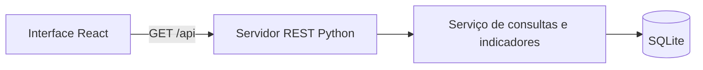

# Decisões da implementação inicial

Registro de 11/11/2026. Complementa a [base do projeto](BASE_DO_PROJETO.md), sem substituir as entregas formais da disciplina.

## Escopo implementado

Primeiro caminho completo: banco SQLite → API REST → painel em React. A interface permite consultar indicadores, filtrar o recorte, navegar para detalhes e examinar o histórico de uma especialidade. O nome Pulso é provisório, pois ainda não houve escolha definitiva do nome do produto.

React foi solicitado pelo usuário. Python e SQLite foram escolhidos como uma base local simples, sem dependências adicionais no backend. O frontend é compilado pelo Vite. Usuários e permissões permanecem adiados conforme orientação do grupo.

## Organização

A API fornece dados agregados, sem registros de pacientes. As consultas usam parâmetros SQL. As taxas são calculadas no backend para manter a mesma regra em todas as telas.

O servidor Python também pode entregar os arquivos compilados do React. Durante o desenvolvimento, o proxy do Vite encaminha as requisições REST para a API.

## Modelo inicial dos dados

- `regions`: Geres representadas na demonstração.
- `units`: unidades executantes fictícias, cada uma ligada a uma Geres.
- `specialties`: itens de agendamento representados como especialidades/procedimentos.
- `observations`: registro mensal por unidade e especialidade, com oferta, agendamentos, faltas, demanda e fila.

A chave do registro mensal é `(period, unit_id, specialty_id)`. O banco impede contagens negativas, agendamentos maiores que a oferta e faltas maiores que os agendamentos. A geração é determinística e ocorre apenas quando não existem observações; não sobrescreve registros ao reiniciar.

### Hipóteses específicas da simulação

1. Demanda e fila são distribuídas entre unidades de forma exclusiva, para que possam ser somadas sem duplicação. Esse vínculo é uma simplificação fictícia; não foi comprovado como regra do CMCE.
2. O filtro Geres representa a região da unidade executante. A distribuição por Geres solicitante, citada no material original, exige um modelo adicional e não está implementada.
3. Cada mês é um cenário independente. O histórico não representa uma simulação longitudinal de pacientes; não se deve inferir crescimento real da fila a partir desses registros.
4. Todos os agendamentos do mês têm desfecho: atendimento ou falta. Não há cancelamentos, pendências ou reagendamentos nesta versão.
5. O saldo de fila é uma fotografia no fim do mês. A API consulta um período por vez e não soma saldos entre meses.
6. Os dados incluem pressão de demanda, oferta ociosa e um cenário de Neurologia na unidade Sertão com oferta zero e fila positiva.

## Fórmulas adotadas

Considere `O` = oferta, `A` = agendamentos e `F` = faltas, somados para o mesmo recorte e mês.

| Indicador | Cálculo | Caso excepcional |
|---|---|---|
| Vagas livres | `O − A` | Zero quando todas as vagas estão agendadas. |
| Ocupação (%) | `100 × A / O` | `null` se `O = 0`. |
| Perda primária (%) | `100 × (O − A) / O` | `null` se `O = 0`. |
| Perda secundária (%) | `100 × F / A` | `null` se `A = 0`. |
| Atendimentos estimados na simulação | `A − F` | Derivado apenas sob a hipótese de desfechos completos. |

Exemplo: 100 vagas, 80 agendamentos e 8 faltas resultam em 20 vagas livres, 80% de ocupação, 20% de perda primária e 10% de perda secundária.

Percentuais são calculados sobre as somas e arredondados para duas casas na API. A interface exibe até uma casa decimal. Não é utilizada média simples dos percentuais das unidades.

`null` significa não calculável e é exibido como “—”. A atual base possui contagens completas; valores ausentes precisam de tratamento próprio se houver importação futura. Não devem ser convertidos silenciosamente em zero.

## Funcionalidades e rastreabilidade preliminar

| Requisito da base | Situação nesta versão |
|---|---|
| RF-P01 | Tabela por especialidade/procedimento. |
| RF-P02 | Fila total no recorte; a Geres é da unidade executante, não da solicitante. Atendimento parcial. |
| RF-P03 | Oferta filtrável por unidade e Geres; sem tabela de distribuição por unidade. Atendimento parcial. |
| RF-P04 | Ocupação e perdas com denominadores documentados. |
| RF-P05, RF-P06, RF-P07 | Ainda não implementados: cobertura, pressão, médias de entradas/saídas e diagnóstico. Demanda mensal exibida não equivale à média de entradas. |
| RF-P08, RF-P09 | Filtros de período, Geres executante, unidade e especialidade. |
| RF-P10, RF-P11 | Envio de agendas fora desta primeira implementação; escopo permanece pendente. |

O painel não implementa score, classificação de risco, previsão de esvaziamento ou diagnóstico assistencial. As cores dos gráficos diferenciam séries; não sinalizam risco clínico. Esses cálculos dependem de regras demonstrativas a propor e documentar em uma etapa posterior.

## Próximas decisões

- Confirmar se o envio de agendas integra o próximo incremento.
- Propor fórmulas de cobertura, pressão, score e diagnósticos, com exemplos verificáveis.
- Definir a separação entre Geres solicitante e executante para aproximar o modelo do domínio.
- Detalhar usuários e permissões quando o grupo retomar o tema.
- Transformar esta implementação e suas decisões nos modelos de análise e arquitetura exigidos pelo professor.
